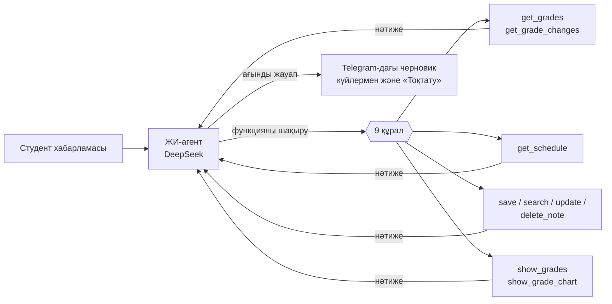
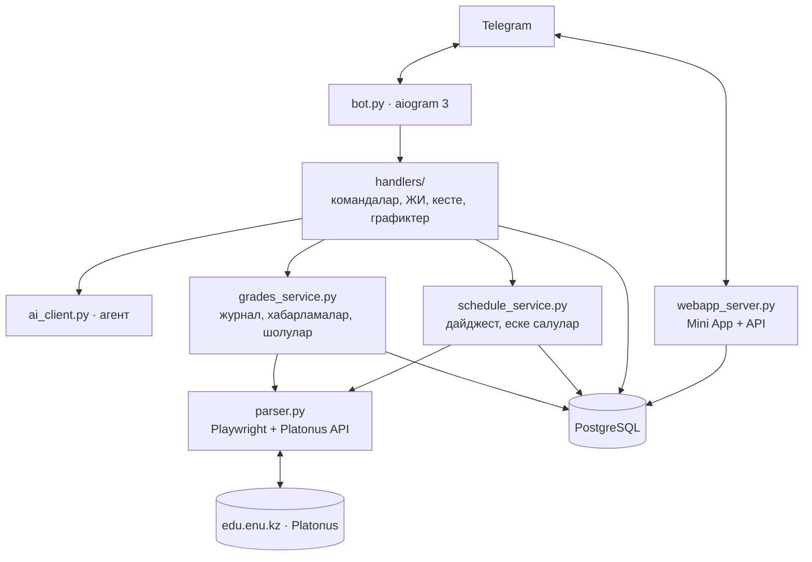

🇰🇿 **Қазақша** · 🇷🇺 [Русский](README.ru.md)

# Aura — ЕҰУ студентіне арналған ЖИ-көмекші

> Platonus-қа қосылатын Telegram-бот және Mini App. Жаңа бағалар мен рубежкаларды
> бірден хабарлайды, жасанды интеллект арқылы бағаларды талдайды, таңертең сабақ
> кестесін жібереді, сабаққа 15 минут қалғанда аудиторияны немесе Teams сілтемесін
> еске салады. Интерфейс — қазақ (әдепкі) және орыс тілдерінде.

**Демо:** [t.me/plt_pars_bot](https://t.me/plt_pars_bot)

---

## Мәселе

- Platonus **хабарлама жібермейді**: жаңа баға немесе рубежка қойылғанын студент
  кездейсоқ біледі.
- Журнал — ондаған баған (ТК, ТК ОБЩ., РК, Р1, рейтинг допуска). **Емтиханға
  жіберілмеу қаупі қай жерде** және не істеу керек екенін түсіну қиын.
- Кесте, аудиториялар және Teams-тегі онлайн сабақ сілтемелері әр жерде шашырап
  жатыр, ал Platonus телефонда ыңғайсыз.

## Шешім

Aura студенттер онсыз да көп уақыт өткізетін жерде — Telegram-да жұмыс істейді және
Platonus-тың шикі деректерін ана тіліндегі түсінікті кеңестерге айналдырады.

| Мүмкіндік | Қалай көрінеді |
|---|---|
| 🔔 **Жаңа бағалар туралы хабарлама** | Тек апталық бағалар, РК1/РК2 және қорытындылар — ТК мен рейтингтің қайта есептеулерінсіз. Пәндер бойынша топталған |
| 📊 **ЖИ-шолу** әр жаңа бағадан кейін | «Жаңалық · жалпы жағдай · қауіптер · кеңес» — қазақ немесе орыс тілінде 5 жол |
| 💬 **ЖИ-мен сөйлесу** | «Ең нашар сабағым қайсы?», «A алу үшін емтиханнан қанша керек?», «Ертең қандай сабақ бар?» |
| ⌨️ **Жауап көз алдыңда жазылады** | Күйлер («📊 Бағаларды қарап жатырмын…»), біртіндеп пайда болатын мәтін, тоқтату батырмасы |
| 📈 **Прогресс графигі** | Әр пән мен сабақ түрі бойынша апталық баллдар |
| ☀️ **Таңғы дайджест** | Күндегі сабақтар, еске салулар және тәулік ішіндегі жаңа бағалар — таңдалған уақытта |
| ⏰ **Сабаққа 15 минут қалғанда еске салу** | Аудитория мен корпус немесе Teams сілтемесі |
| 📝 **Жазбалар мен еске салулар** | «Ертең 9-да зертхана туралы еске сал» — іздеу қателерді де түсінеді |
| 📱 **Mini App** | Графиктері бар журнал, күндер бойынша кесте, өзгерістер таспасы, жазбалар; жарық және қараңғы тақырып |

## Жасанды интеллект қалай қолданылады

ЖИ — қосымша емес, өнімнің өзегі.



1. **Функцияларды шақыратын агент.** Модель қандай дерек керек екенін өзі шешеді:
   бағалар, өзгерістер, кесте, жазбалар, график. «Функцияны шақыру → нәтиже → жауап»
   циклі 5 қадамға дейін (`ai_client.py`).
2. **ЖИ ұсынған әрекетті тексеру.** Әр шақыру қатаң Pydantic схемасынан өтеді: ЖИ
   басқа біреудің жазбасын өшіре алмайды, сілтеме ойлап таба алмайды, өткен уақытқа
   еске салу қоя алмайды (`assistant_tools.py`).
3. **Құрылымды шолулар.** Бағалар шолуы үшін модель JSON қайтарады (жаңалық / жалпы
   жағдай / қауіптер / кеңес), ал безендіруді бот жинайды — хабарлама әрдайым бірдей
   оқылады (`summarize_grades`).
4. **Ағынды генерация.** Жауап Telegram message drafts арқылы генерация барысында
   көрсетіледі; функция шақырулары ағыннан жиналады (`streaming.py`).
5. **Нұсқаулардағы пәндік білім.** Қорытынды баға формуласы, әріптік шкала, ТК/РК/Р1
   мағынасы, «семестр соңына дейін қорытынды бағандар — қауіп емес» ережесі.
6. **Үнемдеу.** ЖИ бос ұяшықтарсыз ықшам журналды (көлемі −33 %) және тек қатысты
   жазбаларды (анық емес іздеу) алады.

## Архитектура



| Модуль | Мақсаты |
|---|---|
| `bot.py` | Іске қосу: бот, бағаларды фондық тексеру, дайджест, еске салулар, Mini App сервері |
| `handlers/` | Telegram командалары, ЖИ-мен сөйлесу, кесте, графиктер, Mini App |
| `ai_client.py`, `assistant_tools.py`, `streaming.py` | ЖИ-агент, оның құралдары, ағынды жауаптар |
| `grades_service.py`, `grade_changes.py` | Журнал: суреттерді салыстыру, маңызды өзгерістерді сүзу, хабарламалар |
| `schedule.py`, `schedule_service.py` | Кесте: талдау, қатар сабақтарды біріктіру, дайджест, еске салулар |
| `parser.py` | Platonus-қа кіру, сақталған сессиялар, кесте API жауабын ұстау |
| `webapp/`, `webapp_server.py`, `dashboard.py` | Mini App және оның Telegram қолтаңбасын тексеретін API |
| `database.py`, `migrations/` | Қосылымдар пулы арқылы PostgreSQL, деректер базасының схемасы |

## SMART.ENU-мен интеграция

Aura ЕҰУ деректерімен қазірдің өзінде жұмыс істейді: үлгерім журналы және **Platonus
кестесінің REST API** (`/rest/schedule/userSchedule/student/...`). Деректер модельдері —
журнал суреті, баға өзгерістері, кесте — `migrations/` ішінде сипатталған және оңай
көшіріледі.

SMART.ENU-мен ресми интеграция кезінде:

- Platonus құпиясөзін сақтаудың орнына **ЕҰУ бірыңғай аккаунты (OAuth/SSO)** арқылы кіру;
- бағалар мен кестені браузерсіз, **тікелей API арқылы** алу — 10–50 есе жылдам;
- мерзімді тексерудің орнына жаңа бағалар туралы **вебхуктер**;
- университет үшін — иесіздендірілген аналитика: емтиханға жіберілмеу қаупі туралы ерте
  ескертулер.

## Қауіпсіздік және дербес деректер

- Platonus құпиясөзі **шифрланады** (Fernet, AES-128) және ашық түрде сақталмайды;
  құпиясөзі бар хабарламаны бот чаттан **бірден өшіреді**.
- Бот тек студенттің өз аккаунтындағы деректерімен, оның келісімімен жұмыс істейді.
- Mini App **Telegram қолтаңбасын (initData)** тексереді — әркім тек өз деректерін
  көреді; ескірген және жалған сұраулар қабылданбайды (тесттермен тексерілген).
- Құпия деректер (`.env`, шифрлау кілті) репозиторийге түспейді.
- Өнеркәсіптік пайдалану үшін — ҚР аумағындағы сервер (дербес деректер туралы заң).

## Техникалық сапа

- **86 автотест** (`pytest`): журналдарды салыстыру, хабарламалар, ЖИ құралдары,
  ағынды жауаптар, кесте мен дайджест, графиктер, Mini App қауіпсіздігі.
- Docker және `docker-compose`, деректер базасы схемасының миграциялары, ротациясы бар
  файлдық лог.
- Тұрақтылық: сәтсіз кіруден кейінгі үзілістер, ботты бұғаттаған пайдаланушыларды
  өткізіп жіберу, Platonus сессиясын қайта пайдалану, бір ортақ браузер.

## Іске қосу

```bash
python -m venv .venv
.venv\Scripts\activate
pip install -r requirements-dev.txt
playwright install chromium
copy .env.example .env      # толтыру керек
python create_key.py        # бір рет: құпиясөздерді шифрлау кілті
```

Деректер базасы (бір рет, `postgres` атынан):

```bash
psql -U postgres -d aura_ai -f migrations/001_initial.sql
psql -U postgres -d aura_ai -f migrations/002_reminders_and_disconnect.sql
psql -U postgres -d aura_ai -f migrations/003_schedule_and_digest.sql
```

```bash
python bot.py        # бот
python -m pytest     # тесттер
```

**Сервер:** `docker compose up -d --build` (`docker-compose.yml` қараңыз).
**Компьютерден Mini App:** `WEBAPP_TUNNEL=1` және орнатылған `cloudflared`.
**Mini App-ты алдын ала қарау:** `python tools/webapp_preview.py` → http://127.0.0.1:8090/preview

## Бот командалары

| Команда | Не істейді |
|---|---|
| `/start` | Сәлемдесу |
| `/connect` | Platonus-ты қосу |
| `/grades` | Бағалар журналы және ЖИ-шолу |
| `/chart` | Прогресс графигі (`/chart блокчейн` — бір пән) |
| `/schedule` | Бүгінгі және ертеңгі сабақтар |
| `/digest` | Дайджест пен еске салу баптаулары |
| `/app` | Mini App-ты ашу |
| `/lang` | Тіл: қазақша / русский |

## Даму жоспары

1. ҚР-дағы сервер, Mini App-тың тұрақты мекенжайы.
2. Браузердің орнына Platonus API-ына тікелей сұраулар.
3. Сессия модулі: емтихан кестесі, «емтиханнан қанша керек», дайындық жоспары.
4. Platonus қолданатын басқа университеттерді қолдау.
5. SMART.ENU-мен интеграция (SSO, API, вебхуктер).

## Бөгде кітапханалар және лицензиялар

| Кітапхана | Лицензия |
|---|---|
| aiogram | MIT |
| openai-python | Apache-2.0 |
| Playwright | Apache-2.0 |
| psycopg, psycopg-pool | LGPL-3.0 |
| Pydantic | MIT |
| python-dotenv | BSD-3-Clause |
| cryptography | Apache-2.0 / BSD |
| matplotlib | Matplotlib License (BSD-үйлесімді) |
| aiohttp | Apache-2.0 |
| tzdata | Apache-2.0 |
| PostgreSQL | PostgreSQL License |
| cloudflared | Apache-2.0 |
| Telegram Web App SDK | Telegram |

ЖИ моделі: DeepSeek API (DeepSeek шарттары бойынша). Деректер: тек пайдаланушының
Platonus аккаунтындағы өз деректері, оның келісімімен.
