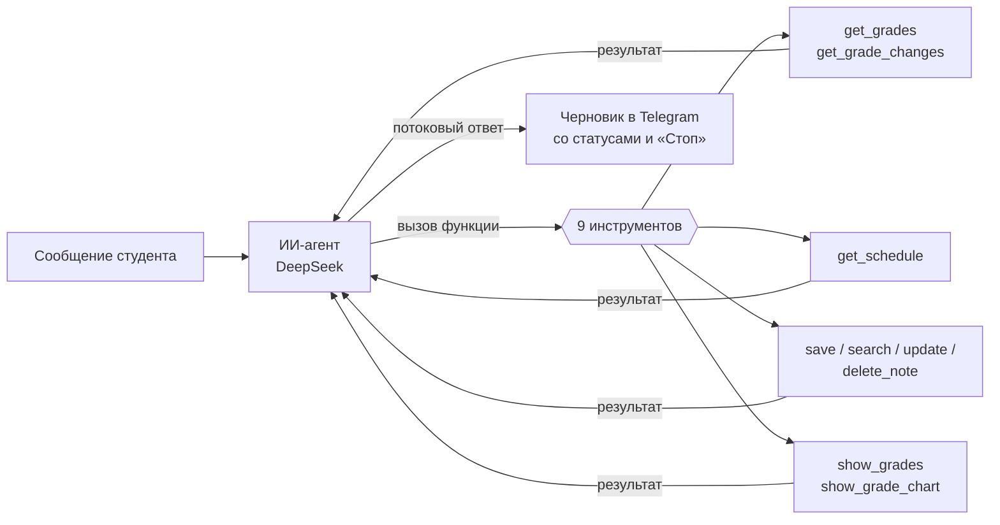
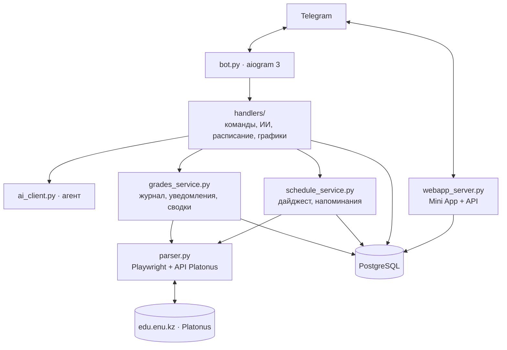

🇰🇿 [Қазақша](README.md) · 🇷🇺 **Русский**

# Aura — ИИ-помощник студента ЕНУ

> Telegram-бот и Mini App, которые подключаются к Platonus. Сразу сообщает о новых
> оценках и рубежках, разбирает оценки с помощью ИИ, утром присылает расписание,
> за 15 минут до пары напоминает аудиторию или ссылку на Teams. Интерфейс —
> на казахском (по умолчанию) и русском языках.

**Демо:** [t.me/plt_pars_bot](https://t.me/plt_pars_bot)

---

## Проблема

- Platonus **не присылает уведомлений**: о новой оценке или рубежке студент узнаёт случайно.
- Журнал — это десятки столбцов (ТК, ТК ОБЩ., РК, Р1, рейтинг допуска). Трудно понять,
  **где риск недопуска** и что делать.
- Расписание, аудитории и ссылки на онлайн-пары в Teams разбросаны по разным местам,
  а интерфейс Platonus неудобен на телефоне.

## Решение

Aura живёт там, где студенты и так проводят время, — в Telegram — и превращает
сырые данные Platonus в понятные подсказки на родном языке.

| Функция | Как это выглядит |
|---|---|
| 🔔 **Уведомления о новых оценках** | Только оценки за неделю, РК1/РК2 и итоги — без шума пересчётов ТК и рейтинга. Сгруппировано по предметам |
| 📊 **ИИ-сводка** после каждой новой оценки | «Что нового · общая картина · риски · совет», 5 строк на казахском или русском |
| 💬 **Разговор с ИИ** | «Ең нашар сабағым қайсы?», «сколько нужно на экзамене для A?», «ертең қандай сабақ бар?» |
| ⌨️ **Ответ печатается на глазах** | Статусы («📊 Бағаларды қарап жатырмын…»), постепенный текст, кнопка остановки |
| 📈 **График прогресса** | Баллы по неделям для каждого предмета и типа занятия |
| ☀️ **Утренний дайджест** | Пары на день, напоминания и новые оценки за сутки — в выбранное время |
| ⏰ **Напоминание за 15 минут до пары** | Аудитория и корпус или ссылка на Teams |
| 📝 **Заметки и напоминания** | «Ертең 9-да зертхана туралы еске сал» — поиск понимает опечатки |
| 📱 **Mini App** | Журнал с графиками, расписание по дням, лента изменений, заметки; светлая и тёмная тема |

## Как используется ИИ

ИИ — не дополнение, а ядро продукта.



1. **Агент с вызовом функций.** Модель сама решает, какие данные нужны: оценки,
   изменения, расписание, заметки, график. Цикл «вызов функции → результат → ответ»
   до 5 шагов (`ai_client.py`).
2. **Проверка того, что предлагает ИИ.** Каждый вызов проходит строгую схему Pydantic:
   ИИ не может удалить чужую заметку, придумать ссылку или поставить напоминание в прошлое
   (`assistant_tools.py`).
3. **Структурированные сводки.** Для сводки оценок модель возвращает JSON
   (новое / общая картина / риски / совет), а оформление собирает бот — сообщение всегда
   одинаково читаемое (`summarize_grades`).
4. **Потоковая генерация.** Ответ показывается по мере генерации через Telegram
   message drafts; вызовы функций собираются из потока (`streaming.py`).
5. **Предметные знания в инструкциях.** Формула итоговой оценки, буквенная шкала,
   смысл ТК/РК/Р1, правило «итоговые столбцы до конца семестра — не риск».
6. **Экономия.** ИИ получает компактный журнал без пустых ячеек (−33 % объёма)
   и только подходящие заметки (нечёткий поиск), а не всё подряд.

## Архитектура



| Модуль | Назначение |
|---|---|
| `bot.py` | Запуск: бот, фоновая проверка оценок, дайджест, напоминания, сервер Mini App |
| `handlers/` | Команды Telegram, разговор с ИИ, расписание, графики, Mini App |
| `ai_client.py`, `assistant_tools.py`, `streaming.py` | ИИ-агент, его инструменты, потоковые ответы |
| `grades_service.py`, `grade_changes.py` | Журнал: сравнение снимков, фильтр важных изменений, уведомления |
| `schedule.py`, `schedule_service.py` | Расписание: разбор, склейка пар, дайджест, напоминания |
| `parser.py` | Вход в Platonus, сохранённые сессии, перехват ответа API расписания |
| `webapp/`, `webapp_server.py`, `dashboard.py` | Mini App и его API с проверкой подписи Telegram |
| `database.py`, `migrations/` | PostgreSQL через пул соединений, схема базы |

## Интеграция со SMART.ENU

Aura уже работает с данными ЕНУ: журнал успеваемости и **REST API расписания Platonus**
(`/rest/schedule/userSchedule/student/...`). Модели данных — снимок журнала,
изменения оценок, расписание — описаны в `migrations/` и легко переносятся.

При официальной интеграции со SMART.ENU:

- вход через **единую учётную запись ЕНУ (OAuth/SSO)** вместо хранения пароля Platonus;
- получение оценок и расписания **напрямую через API**, без браузера — быстрее в 10–50 раз;
- **вебхуки** о новых оценках вместо периодической проверки;
- для университета — обезличенная аналитика: ранние предупреждения о риске недопуска.

## Безопасность и персональные данные

- Пароль Platonus **шифруется** (Fernet, AES-128) и не хранится в открытом виде;
  сообщение с паролем бот **сразу удаляет** из чата.
- Бот работает только с данными самого студента из его аккаунта, с его согласия.
- Mini App проверяет **подпись Telegram (initData)** — каждый видит только свои данные;
  устаревшие и поддельные запросы отклоняются (покрыто тестами).
- Секреты (`.env`, ключ шифрования) не попадают в репозиторий.
- Для промышленной эксплуатации — сервер на территории РК (закон о персональных данных).

## Техническое качество

- **86 автотестов** (`pytest`): сравнение журналов, уведомления, ИИ-инструменты,
  потоковые ответы, расписание и дайджест, графики, безопасность Mini App.
- Docker и `docker-compose`, миграции схемы базы, лог в файл с ротацией.
- Устойчивость: паузы после неудачных входов, пропуск пользователей, заблокировавших бота,
  повторное использование сессии Platonus, один общий браузер.

## Запуск

```bash
python -m venv .venv
.venv\Scripts\activate
pip install -r requirements-dev.txt
playwright install chromium
copy .env.example .env      # заполнить
python create_key.py        # один раз: ключ шифрования паролей
```

База (один раз, от имени `postgres`):

```bash
psql -U postgres -d aura_ai -f migrations/001_initial.sql
psql -U postgres -d aura_ai -f migrations/002_reminders_and_disconnect.sql
psql -U postgres -d aura_ai -f migrations/003_schedule_and_digest.sql
```

```bash
python bot.py        # бот
python -m pytest     # тесты
```

**Сервер:** `docker compose up -d --build` (см. `docker-compose.yml`).
**Mini App с компьютера:** `WEBAPP_TUNNEL=1` и установленный `cloudflared`.
**Предпросмотр Mini App:** `python tools/webapp_preview.py` → http://127.0.0.1:8090/preview

## Команды бота

| Команда | Что делает |
|---|---|
| `/start` | Приветствие |
| `/connect` | Подключить Platonus |
| `/grades` | Журнал оценок и ИИ-сводка |
| `/chart` | График прогресса (`/chart блокчейн` — один предмет) |
| `/schedule` | Пары на сегодня и завтра |
| `/digest` | Настройки дайджеста и напоминаний |
| `/app` | Открыть Mini App |
| `/lang` | Язык: қазақша / русский |

## План развития

1. Сервер в РК, постоянный адрес Mini App.
2. Прямые запросы к API Platonus вместо браузера.
3. Модуль сессии: расписание экзаменов, «сколько нужно на экзамене», план подготовки.
4. Поддержка других вузов на Platonus.
5. Интеграция со SMART.ENU (SSO, API, вебхуки).

## Сторонние библиотеки и лицензии

| Библиотека | Лицензия |
|---|---|
| aiogram | MIT |
| openai-python | Apache-2.0 |
| Playwright | Apache-2.0 |
| psycopg, psycopg-pool | LGPL-3.0 |
| Pydantic | MIT |
| python-dotenv | BSD-3-Clause |
| cryptography | Apache-2.0 / BSD |
| matplotlib | Matplotlib License (BSD-совместимая) |
| aiohttp | Apache-2.0 |
| tzdata | Apache-2.0 |
| PostgreSQL | PostgreSQL License |
| cloudflared | Apache-2.0 |
| Telegram Web App SDK | Telegram |

ИИ-модель: DeepSeek API (условия DeepSeek). Данные: только данные пользователя из его
аккаунта Platonus, с его согласия.
